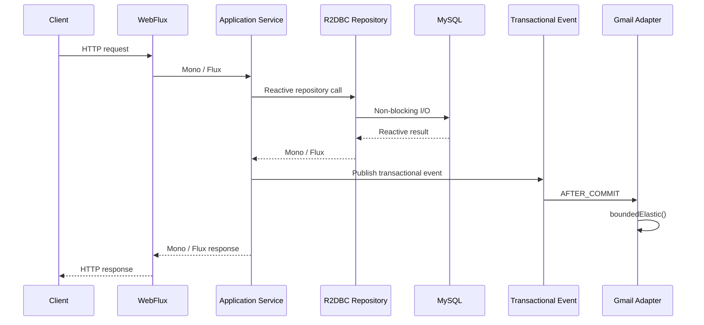

# Arquitectura del microservicio PQRS

Este archivo resume las decisiones estructurales. El `README.md` contiene la explicación paso a paso, diagramas Mermaid, instalación y operación.

## Capas

```text
WebFlux / API REST
  ↓
application
  ↓
domain
  ↑
infrastructure/persistence + infrastructure/email
```

### API REST + WebFlux

`api/rest` recibe HTTP mediante Spring WebFlux. Los controllers trabajan con `Mono` y `Flux`, validan DTOs y transforman errores a respuestas HTTP. No conocen SQL ni SMTP.

### Application

`PqrsService` coordina los casos de uso y devuelve publishers Reactor. Usa repositories reactivos y publica eventos transaccionales reactivos.

### Domain

Los enums y excepciones mantienen las reglas de estados, tipos y plazos. Las entidades conservan la lógica de transición del dominio.

### Persistence

Spring Data R2DBC implementa el Repository Pattern. Las entidades usan `@Table`, `@Id` y `@Column` del modelo relacional de Spring Data, con claves foráneas (`citizenId`, `responsibleId`, `answerId`) en lugar de asociaciones JPA/Hibernate.

### Email

`EmailSenderPort` devuelve `Mono<Void>`. `GmailEmailAdapter` integra `JavaMailSender` y desplaza la operación bloqueante a `Schedulers.boundedElastic()`. `NoOpEmailAdapter` permite ejecutar sin Gmail.

Las notificaciones continúan usando `@TransactionalEventListener(AFTER_COMMIT)` y eventos publicados con `TransactionalEventPublisher` para conservar el contexto de la transacción reactiva.

## Base de datos

Producción: MySQL + R2DBC.

Desarrollo: H2 + R2DBC.

Flyway utiliza JDBC únicamente durante el arranque para versionar el esquema. No se utiliza Hibernate/JPA en el request path.

## Flujo


