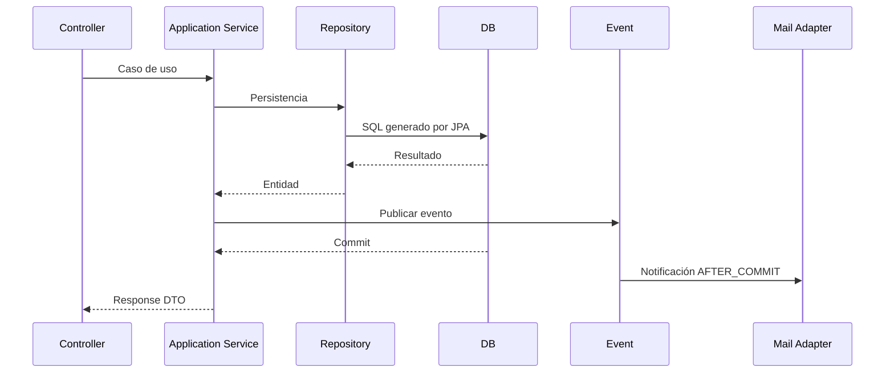

# Arquitectura del microservicio PQRS

Este archivo resume las decisiones estructurales. El `README.md` contiene la explicación paso a paso, diagramas Mermaid, instalación y operación.

## Capas

```text
api/rest
  ↓
application
  ↓
domain
  ↑
 infrastructure/persistence + infrastructure/email
```

### API

Recibe HTTP, valida DTOs y transforma errores a respuestas HTTP. Los controladores no conocen SQL ni SMTP.

### Application

`PqrsService` coordina los casos de uso y usa repositorios. Publica eventos como `PqrsCreatedEvent`, `PqrsAssignedEvent` y `PqrsAnsweredEvent` cuando una operación de negocio termina correctamente.

### Domain

Los enums y excepciones mantienen las reglas de estados, tipos y plazos. Las entidades actuales contienen la lógica de transición para preservar el comportamiento heredado.

### Persistence

Spring Data JPA implementa el Repository Pattern. Las entidades JPA se mantienen en infraestructura para no convertir los DTO de la API en modelos de persistencia.

### Email

`EmailSenderPort` define la necesidad de enviar correo. `GmailEmailAdapter` implementa esa necesidad mediante `JavaMailSender`. `NoOpEmailAdapter` permite ejecutar el proyecto sin credenciales de Gmail.

La notificación usa `@TransactionalEventListener(AFTER_COMMIT)`: una notificación fallida no revierte una transacción ya confirmada.

## Base de datos

Producción: MySQL.

Desarrollo: H2.

El esquema se controla mediante Flyway y `ddl-auto=validate` para evitar modificaciones automáticas del esquema por Hibernate.

## Configuración

- `.env` local: no se versiona.
- Clever Cloud: variables de entorno inyectadas por plataforma/add-on.
- `application.yml`: solo define nombres, defaults no sensibles y reglas de configuración.

## Flujo


