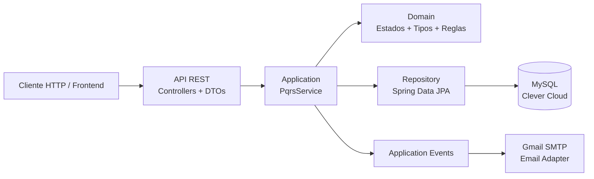
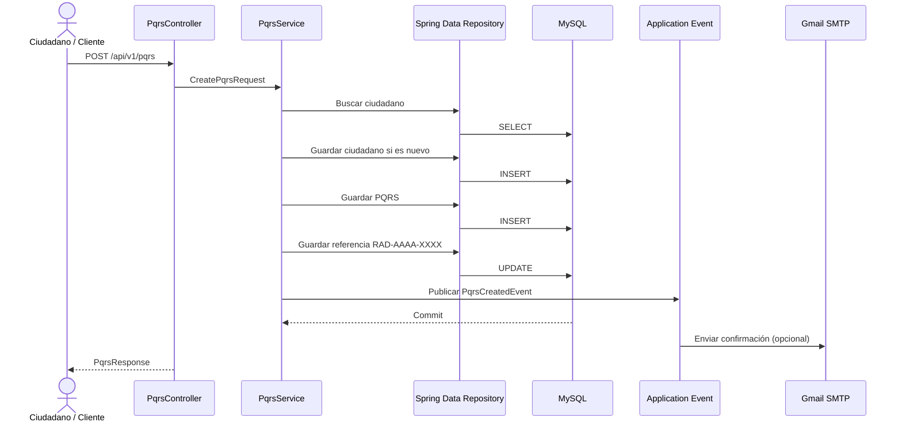
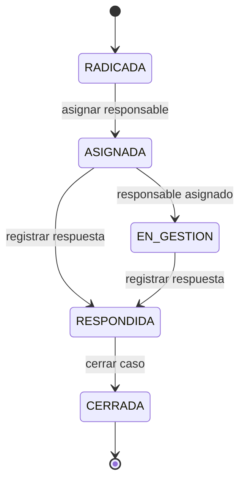
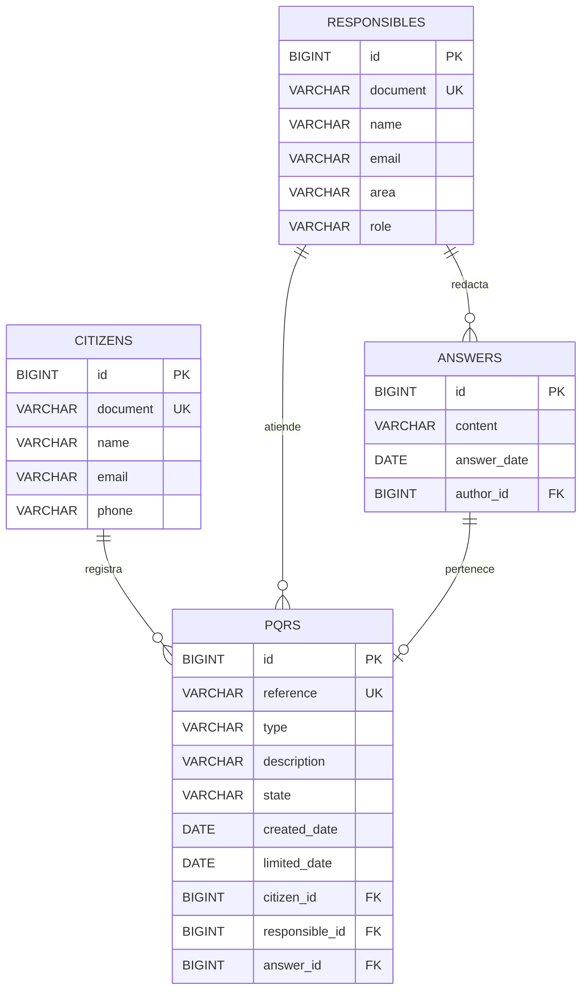
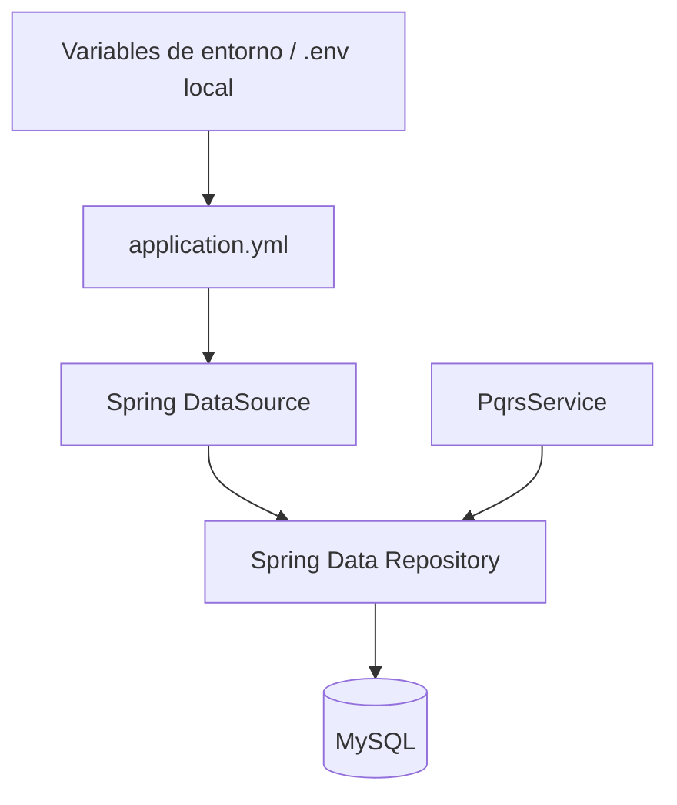
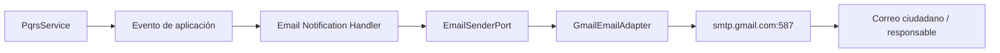
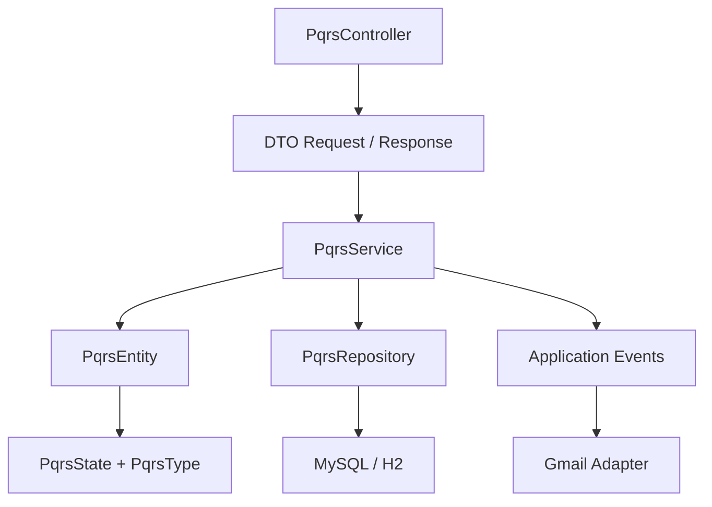

# PQRS Microservice · Spring Boot 4 + MySQL + Gmail

Microservicio REST para registrar, consultar y gestionar **PQRS (Petición, Queja, Reclamo y Sugerencia)**.

La versión actual conserva la lógica de negocio del proyecto original y la lleva a una arquitectura preparada para persistencia real, despliegue en **Clever Cloud**, notificaciones por **Gmail SMTP** y evolución como microservicio.

> **Objetivo de esta versión:** que el proyecto no solo funcione, sino que sea fácil de leer, mantener, desplegar y aprender.

---

## 1. ¿Qué cambió?

En el proyecto original ya existían JPA y repositorios, pero H2 era la base principal y PostgreSQL estaba preparado como alternativa. Esta versión hace explícito el camino hacia **MySQL + Clever Cloud** y añade:

- MySQL como base de datos objetivo.
- H2 como entorno de desarrollo local sin infraestructura externa.
- Repository Pattern mediante Spring Data JPA.
- Migraciones versionadas con Flyway.
- `.env.example` y carga opcional de `.env` local.
- `.gitignore` reforzado para no subir secretos, IDE metadata ni datos locales.
- Notificaciones por Gmail mediante SMTP.
- Eventos de aplicación y listener `AFTER_COMMIT` para no hacer que un fallo de correo revierta la operación de negocio.
- Docker Compose con MySQL para probar el mismo stack de base de datos localmente.
- Script SQL explícito de la base de datos en `database/schema-mysql.sql`.
- README rediseñado con diagramas Mermaid y explicación de responsabilidades.
- Endpoint Actuator para consultar el estado de las migraciones Flyway.

### Algo importante

Las credenciales de base de datos y Gmail **no están escritas en el código fuente**. Se obtienen desde variables de entorno o desde `.env` local, y `.env` está excluido de Git.

---

## 2. Arquitectura general

El proyecto sigue una organización por responsabilidades: la API recibe peticiones, la capa de aplicación coordina casos de uso, el dominio conserva reglas y la infraestructura se encarga de tecnología externa.



### ¿Por qué cada cosa está donde está?

| Carpeta | Responsabilidad | Qué NO debería hacer |
|---|---|---|
| `api/rest` | HTTP, JSON, validación y DTOs | Consultar MySQL directamente |
| `application` | Coordinar casos de uso y publicar eventos | Contener detalles de SMTP o JDBC |
| `domain` | Estados, tipos y reglas de negocio | Saber que existe MySQL, Gmail o Spring MVC |
| `infrastructure/persistence` | Entidades JPA y repositorios | Definir la lógica de los casos de uso |
| `infrastructure/email` | Integración real con Gmail/SMTP | Decidir reglas de negocio |
| `infrastructure/config` | Seed y monitor programado | Resolver lógica HTTP |
| `resources/db/migration` | Evolución versionada del esquema | Contener lógica Java |

La idea es que cada capa tenga una razón concreta para existir. Esto reduce el acoplamiento y facilita cambiar una tecnología sin tener que modificar todo el proyecto.

---

## 3. Estructura del proyecto

```text

pqrs-spring-boot/

├── database/
│   └── schema-mysql.sql
├── src/
│   ├── main/
│   │   ├── java/com/pqrs/microservice/
│   │   │   ├── api/rest/
│   │   │   │   ├── dto/
│   │   │   │   ├── ApiExceptionHandler.java
│   │   │   │   ├── PqrsController.java
│   │   │   │   └── ResponsibleController.java
│   │   │   │
│   │   │   ├── application/
│   │   │   │   ├── event/
│   │   │   │   ├── port/out/
│   │   │   │   │   └── EmailSenderPort.java
│   │   │   │   └── PqrsService.java
│   │   │   │
│   │   │   ├── domain/
│   │   │   │   ├── enums/
│   │   │   │   └── exception/
│   │   │   │
│   │   │   ├── infrastructure/
│   │   │   │   ├── config/
│   │   │   │   ├── email/
│   │   │   │   └── persistence/
│   │   │   │       ├── entity/
│   │   │   │       └── repository/
│   │   │   │
│   │   │   └── PqrsApplication.java
│   │   │
│   │   └── resources/
│   │       ├── db/migration/
│   │       │   ├── h2/
│   │       │   └── mysql/
│   │       └── application.yml
│   │
│   └── test/
│       └── java/com/pqrs/microservice/
├── .env.example
├── .gitignore
├── Dockerfile
├── docker-compose.yml
├── pom.xml
├── requests.http
├── ARCHITECTURE.md
└── README.md
```

---

## 4. Flujo completo de una PQRS



El correo se escucha en la fase `AFTER_COMMIT`: primero se confirma la operación de negocio y luego se intenta notificar. Así, una caída de Gmail no convierte una PQRS registrada correctamente en una operación fallida.

---

## 5. Ciclo de vida y reglas de negocio



Reglas principales:

1. Una PQRS debe tener responsable antes de pasar a `EN_GESTION`.

2. Solo `ASIGNADA` puede pasar a `EN_GESTION`.

3. La respuesta puede registrarse desde `ASIGNADA` o `EN_GESTION`.

4. No se puede cerrar una PQRS sin respuesta.

5. Solo una PQRS `RESPONDIDA` puede cerrarse.

6. Una PQRS cerrada no puede reasignarse.

Los plazos viven en `PqrsType`:

| Tipo | Máximo de respuesta |
|---|---:|
| `PETICION` | 15 días |
| `QUEJA` | 5 días |
| `RECLAMO` | 5 días |
| `SUGERENCIA` | 10 días |

---

## 6. Modelo entidad-relación

El modelo se basa en cuatro entidades persistentes. Un ciudadano puede registrar muchas PQRS; una PQRS puede tener un responsable; una PQRS puede tener una respuesta; y cada respuesta tiene un responsable autor.



### Por qué este modelo

**`citizens`** contiene la identidad y datos de contacto de quien radica la PQRS. Se separa porque el mismo ciudadano puede registrar varias PQRS.

**`responsibles`** representa a los funcionarios/equipo que atienden los casos. Un responsable puede aparecer en muchas PQRS.

**`answers`** está separada para conservar autor, fecha y contenido de la respuesta.

**`pqrs`** concentra el caso de negocio: referencia, tipo, descripción, estado, fechas y relaciones.

La estructura evita duplicar nombre, correo y documento del ciudadano o del responsable en cada fila de PQRS.

---

## 7. Repository Pattern: ¿qué es y por qué lo usamos?

El repositorio es la frontera entre el caso de uso y la persistencia.

Ejemplo:

```java

public interface PqrsRepository extends JpaRepository<PqrsEntity, Long> {

    Optional<PqrsEntity> findByReferenceIgnoreCase(String reference);

    List<PqrsEntity> findAllByStateNotAndLimitedDateBefore(

        PqrsState state,

        LocalDate date

    );

}

```

La capa de aplicación puede decir:

```java

pqrsRepository.findByReferenceIgnoreCase(reference);

```

sin construir manualmente:

```sql

SELECT ... FROM pqrs WHERE reference = ?;

```

Spring Data JPA genera la implementación del repositorio y utiliza el `DataSource` configurado por Spring Boot.

### Seguridad

El Repository Pattern **no es el mecanismo que protege una contraseña**. La separación correcta es:



Las credenciales viven fuera del código. El repositorio encapsula la persistencia.

---

## 8. `.env` y configuración segura

Spring Boot soporta configuración externa y propiedades importadas desde archivos. Este proyecto importa opcionalmente `./.env`, mientras que Clever Cloud proporciona sus propias variables de entorno en ejecución.

El ZIP incluye un `.env` de plantilla sin credenciales reales. Si partes del `.env.example`, puedes recrearlo así:

```bash

cp .env.example .env

```

En Windows puedes copiarlo desde el explorador o con PowerShell:

```powershell

Copy-Item .env.example .env

```

### Para desarrollo con H2

En `.env`:

```env

SPRING_PROFILES_ACTIVE=dev

SEED_DATA_ENABLED=true

MAIL_ENABLED=false

```

### Para MySQL local

```env

SPRING_PROFILES_ACTIVE=mysql

DB_HOST=localhost

DB_PORT=3306

DB_NAME=pqrs

DB_USERNAME=pqrs_app

DB_PASSWORD=pqrs_app

```

### Para Clever Cloud

En producción no necesitas subir este `.env`: configura las variables directamente en Clever Cloud. Cuando enlazas el add-on MySQL a la aplicación, Clever Cloud expone variables como `MYSQL_ADDON_HOST`, `MYSQL_ADDON_PORT`, `MYSQL_ADDON_DB`, `MYSQL_ADDON_USER` y `MYSQL_ADDON_PASSWORD`. La configuración del proyecto las prioriza automáticamente. Para producción, el perfil `mysql` parte con SSL requerido; para desarrollo local con Docker se desactiva explícitamente mediante `DB_USE_SSL=false` y `DB_REQUIRE_SSL=false`.

No necesitas copiar las credenciales de Clever Cloud dentro del repositorio.

---

## 9. MySQL en Clever Cloud

Clever Cloud ofrece MySQL como add-on y documenta las variables de entorno que se inyectan al enlazarlo con una aplicación. También existe ProxySQL para escenarios donde se quiera delegar gestión de conexiones/pooling.

### Pasos

1. Crea una aplicación Java/Maven o Docker en Clever Cloud.

2. Crea un add-on `MySQL`.

3. Vincula el add-on con la aplicación.

4. Verifica que las variables `MYSQL_ADDON_*` estén presentes.

5. Configura:

```env

SPRING_PROFILES_ACTIVE=mysql

SEED_DATA_ENABLED=false

MAIL_ENABLED=false

```

6. Despliega.

Al iniciar, Flyway ejecutará las migraciones pendientes y JPA validará que el modelo Java coincide con el esquema.

### Por qué `ddl-auto=validate`

En producción no conviene que Hibernate modifique automáticamente el esquema. Aquí Hibernate solo valida y **Flyway es quien crea/evoluciona la base de datos**.

---

## 10. Flyway y migraciones

La primera migración es:

```text

src/main/resources/db/migration/mysql/V1__create_schema.sql

```

Y existe una versión equivalente para H2:

```text

src/main/resources/db/migration/h2/V1__create_schema.sql

```

Spring Boot admite Flyway para inicialización y migraciones; el soporte de MySQL requiere el módulo específico `flyway-mysql`. Las migraciones siguen el formato `V<VERSION>__<NAME>.sql`.

Puedes revisar el estado desde:

```text

GET /actuator/flyway

```

---

## 11. SQL manual de MySQL

Si quieres crear la base de datos manualmente antes de conectar Spring Boot, tienes:

```text

database/schema-mysql.sql

```

Este archivo representa la misma estructura de la migración `V1__create_schema.sql`.

Ejemplo de conexión:

```bash

mysql -h HOST -P PORT -u USER -p DATABASE < database/schema-mysql.sql

```

---

## 12. Correo con Gmail

Spring Boot auto-configura `JavaMailSender` cuando está disponible el starter de correo y `spring.mail.host` está configurado. El proyecto usa SMTP de Gmail con STARTTLS y límites de tiempo para evitar hilos bloqueados ante un servidor SMTP que no responda.

### Flujo



### Configuración local

```env

MAIL_ENABLED=true

GMAIL_USERNAME=tu_correo@gmail.com

GMAIL_APP_PASSWORD=xxxx_xxxx_xxxx_xxxx

MAIL_FROM=tu_correo@gmail.com

MAIL_FROM_NAME=PQRS Microservice

```

Google indica que las contraseñas de aplicación requieren que la cuenta tenga activada la verificación en dos pasos. Para el adaptador SMTP de este proyecto se utiliza una contraseña de aplicación, nunca la contraseña normal de la cuenta.

**Nunca uses la contraseña normal de Gmail en `GMAIL_APP_PASSWORD`.**

### ¿Cuándo se envía correo?

- Al radicar una PQRS: confirmación al ciudadano, si tiene correo.

- Al asignar una PQRS: aviso al responsable, si tiene correo.

- Al registrar una respuesta: notificación al ciudadano, si tiene correo.

Puedes desactivar toda esta integración con:

```env

MAIL_ENABLED=false

```

El `NoOpEmailAdapter` permite ejecutar el proyecto sin Gmail configurado.

---

## 13. Datos de prueba

El seed ya no corre automáticamente en cualquier entorno. Se activa explícitamente:

```env

SEED_DATA_ENABLED=true

```

Responsables de demostración:

| Documento | Nombre | Rol | Área |
|---|---|---|---|
| `987654321` | Ana Gomez | `ANALISTA` | Soporte Tecnico |
| `112233445` | Roberto Silva | `SUPERVISOR` | Soporte Tecnico |

Para Clever Cloud se recomienda dejar:

```env

SEED_DATA_ENABLED=false

```

---

## 14. API disponible

### Registrar PQRS

```http

POST /api/v1/pqrs

Content-Type: application/json

```

```json

{

  "type": "QUEJA",

  "description": "El servicio presentó intermitencias durante el fin de semana.",

  "citizen": {

    "document": "101823948",

    "name": "Carlos Mendoza",

    "email": "carlos@gmail.com",

    "phone": "3001234567"

    }

}

```

### Consultar una PQRS

```http

GET /api/v1/pqrs/RAD-2026-0001

```

### Consultar todas

```http

GET /api/v1/pqrs

```

### Consultar responsables

```http

GET /api/v1/responsibles

```

### Crear o actualizar responsable

```http

POST /api/v1/responsibles

```

```json

{

  "document": "123456789",

  "name": "Laura Perez",

  "email": "laura.perez@empresa.com",

  "area": "Atencion al Cliente",

  "role": "ANALISTA"

}

```

### Asignar responsable

```http

POST /api/v1/pqrs/{reference}/assignment

```

### Pasar a gestión

```http

POST /api/v1/pqrs/{reference}/management

```

### Registrar respuesta

```http

POST /api/v1/pqrs/{reference}/answer

```

```json

{

  "content": "Se realizó mantenimiento preventivo y el servicio fue restablecido.",

  "authorDocument": "987654321"

}

```

### Cerrar caso

```http

POST /api/v1/pqrs/{reference}/close

```

### Alertas vencidas

```http

GET /api/v1/pqrs/alerts/expired

```

### Actuator

```http

GET /actuator/health

GET /actuator/metrics

GET /actuator/flyway

```

---

## 15. Ejecución con H2

Esta opción es ideal para aprender el código y probar la lógica sin levantar MySQL.

1. Copia `.env.example` a `.env`.

2. Deja:

```env

SPRING_PROFILES_ACTIVE=dev

SEED_DATA_ENABLED=true

MAIL_ENABLED=false

```

3. Verifica que `.env` contenga la configuración local (el proyecto ya incluye una plantilla).

4. Ejecuta:

```bash

mvn spring-boot:run

```

La aplicación usará H2 en:

```text

./data/pqrsdb

```

No necesitas instalar MySQL para este modo.

---

## 16. Ejecución con MySQL local usando Docker

```bash

docker compose up --build

```

La composición levanta:

```text

MySQL 8.4 -> localhost:3306

API       -> localhost:8080

```

El contenedor de la API usa el perfil `mysql` y Flyway crea el esquema automáticamente.

Para detenerlo:

```bash

docker compose down

```

Para borrar también los datos locales:

```bash

docker compose down -v

```

---

## 17. Pruebas

Ejecuta:

```bash

mvn test

```

Las pruebas existentes verifican las reglas del dominio: cálculo de fechas, restricciones de transición y ciclo completo de una PQRS.

Una evolución recomendada es añadir pruebas de integración con MySQL mediante Testcontainers, especialmente antes de un despliegue real.

---

## 18. Cómo entender el código sin perderse

Lee el proyecto en este orden:



### Paso 1 · Controller

Aprende cómo una petición HTTP llega al sistema.

### Paso 2 · DTO

Aprende qué estructura acepta y devuelve la API.

### Paso 3 · Service

Aquí está la coordinación: ciudadanos, PQRS, responsables, respuestas y eventos.

### Paso 4 · Entity

Aquí entiendes cómo el modelo Java representa las tablas.

### Paso 5 · Repository

Aquí entiendes cómo Java consulta y guarda datos sin escribir SQL para cada operación.

### Paso 6 · Migration

Compara la entidad JPA con el SQL real que crea las tablas.

### Paso 7 · Email Adapter

Entiende cómo una tecnología externa se encapsula detrás de `EmailSenderPort`.

---

## 19. Decisiones importantes de diseño

### Una sola entidad para PQRS

No se mantiene una herencia `Complaint / Claim / Request / Suggestion`. La diferencia principal entre tipos es el plazo, por lo que un enum mantiene el modelo más sencillo:

```text

PqrsType

├── PETICION    -> 15 días
├── QUEJA       -> 5 días
├── RECLAMO     -> 5 días
└── SUGERENCIA  -> 10 días

```

### Referencia generada por la base de datos

La referencia se construye después de persistir el ID:

```text

RAD-<año>-<id de 4 dígitos>

```

Ejemplo:

```text

RAD-2026-0001

```

Esto evita un contador estático de JVM y funciona mejor si existen varias instancias del microservicio.

### Eventos para integraciones externas

La persistencia de la PQRS no queda acoplada directamente al protocolo SMTP. `PqrsService` publica un evento y `infrastructure/email` decide cómo notificar.

Esta decisión facilita cambiar Gmail por otro proveedor en el futuro sin reescribir las reglas del caso de uso.

---

## 20. Mejoras futuras sugeridas

Estas mejoras no son necesarias para entender la versión actual, pero son buenos siguientes pasos para llevarla hacia un microservicio de producción más completo:

- **Spring Security + JWT** para autenticación/autorización.

- **Roles y permisos** para ciudadanos, responsables y administradores.

- **Auditoría** (`created_by`, `updated_by`, cambios de estado y fechas).

- **Paginación y filtros** por estado, tipo, responsable y fechas.

- **OpenAPI / Swagger UI** para una documentación interactiva.

- **Testcontainers con MySQL** para pruebas de integración reales.

- **Plantillas HTML de correo** con Thymeleaf.

- **Cola de mensajería** (RabbitMQ/Kafka) cuando el volumen requiera separar completamente la notificación del request HTTP.

- **Observabilidad** con trazas y métricas más completas si el ecosistema de microservicios crece.

---

## 21. Resumen de la filosofía del proyecto

```text

HTTP

 ↓

Controller

 ↓

Application Service

 ↓

Domain rules + Repository

 ↓

Database

     +---- Application Event ----> Email Adapter -> Gmail

```

La regla general es sencilla:

> **Cada cosa tiene una responsabilidad concreta y las credenciales/configuración viven fuera del código.**

Con esta separación el proyecto es más fácil de estudiar hoy y más fácil de evolucionar mañana.

---

## 22. Referencias oficiales

- [Spring Boot · Externalized Configuration](https://docs.spring.io/spring-boot/reference/features/external-config.html)

- [Spring Boot · Sending Email](https://docs.spring.io/spring-boot/reference/io/email.html)

- [Spring Boot · Database Initialization / Flyway](https://docs.spring.io/spring-boot/how-to/data-initialization.html)

- [Flyway · MySQL support](https://documentation.red-gate.com/fd/mysql-277579322.html)

- [Clever Cloud · MySQL](https://www.clever-cloud.com/developers/doc/addons/mysql/)

- [Clever Cloud · Environment Variables](https://www.clever-cloud.com/developers/doc/reference/reference-environment-variables/)

- [Google · App Passwords](https://support.google.com/mail/answer/185833?hl=es-419)

- [Google · 2-Step Verification](https://support.google.com/mail/answer/185839?co=GENIE.Platform%3DAndroid&hl=en)

23. Diagrama de clases

El siguiente diagrama representa la estructura principal de clases de la versión actual del proyecto y muestra cómo se relacionan las capas de API REST, aplicación, persistencia, dominio y configuración.

```mermaid
classDiagram
direction TB

    namespace api_rest {
        class PqrsController {
            -PqrsService service
            +create(CreatePqrsRequest) PqrsResponse
            +findAll() List
            +findByReference(String) PqrsResponse
            +assignResponsible(String, AssignResponsibleRequest) PqrsResponse
            +passToManagement(String) PqrsResponse
            +recordAnswer(String, AnswerRequest) PqrsResponse
            +closeCase(String) PqrsResponse
            +getExpiredAlerts() List
        }

        class ResponsibleController {
            -PqrsService service
            +findAll() List
            +createOrUpdate(ResponsibleRequest) ResponsibleResponse
        }

        class UserController {
            -UserService service
            +findAll() List
            +create(CreateUserRequest) UserResponse
        }

        class ApiExceptionHandler {
            +handleNotFound(PqrsNotFoundException) ProblemDetail
            +handleResponsibleNotFound(ResponsibleNotFoundException) ProblemDetail
            +handleBusinessRule(BusinessRuleException) ProblemDetail
            +handleValidation(MethodArgumentNotValidException) ProblemDetail
        }
    }

    namespace application {
        class PqrsService {
            -PqrsRepository pqrsRepository
            -CitizenRepository citizenRepository
            -ResponsibleRepository responsibleRepository
            +create(CreatePqrsRequest) PqrsResponse
            +findByReference(String) PqrsResponse
            +findAll() List
            +assignResponsible(String, AssignResponsibleRequest) PqrsResponse
            +passToManagement(String) PqrsResponse
            +recordAnswer(String, AnswerRequest) PqrsResponse
            +closeCase(String) PqrsResponse
            +getExpiredAlerts() List
            +createOrUpdateResponsible(ResponsibleRequest) ResponsibleResponse
            +findAllResponsibles() List
        }

        class UserService {
            -UserRepository repository
            -BCryptPasswordEncoder passwordEncoder
            +create(CreateUserRequest) UserResponse
            +findAll() List
        }
    }

    namespace persistence_repository {
        class PqrsRepository {
            <<interface>>
            +findByReferenceIgnoreCase(String) Optional
            +findAllByStateNotAndLimitedDateBefore(PqrsState, LocalDate) List
            +existsByReference(String) boolean
        }

        class CitizenRepository {
            <<interface>>
            +findByDocument(String) Optional
        }

        class ResponsibleRepository {
            <<interface>>
            +findByDocument(String) Optional
        }

        class UserRepository {
            <<interface>>
            +findByUsername(String) Optional
            +findByEmail(String) Optional
            +existsByUsername(String) boolean
            +existsByEmail(String) boolean
            +findAllByOrderByUsernameAsc() List
        }
    }

    namespace persistence_entity {
        class PqrsEntity {
            -Long id
            -String reference
            -PqrsType type
            -String description
            -PqrsState state
            -LocalDate createdDate
            -LocalDate limitedDate
            -CitizenEntity citizen
            -ResponsibleEntity responsible
            -AnswerEntity answer
            +assignResponsible(ResponsibleEntity) void
            +passToManagement() void
            +recordAnswer(AnswerEntity) void
            +closeCase() void
            +setReference(String) void
        }

        class CitizenEntity {
            -Long id
            -String document
            -String name
            -String email
            -String phone
            +updateFrom(String, String, String) void
        }

        class ResponsibleEntity {
            -Long id
            -String document
            -String name
            -String email
            -String area
            -ResponsibleRole role
            +updateFrom(String, String, String, ResponsibleRole) void
        }

        class AnswerEntity {
            -Long id
            -String content
            -LocalDate answerDate
            -ResponsibleEntity author
        }

        class UserEntity {
            -Long id
            -String username
            -String email
            -String passwordHash
            -UserRole role
            -boolean active
            -LocalDateTime createdAt
            -LocalDateTime updatedAt
        }
    }

    namespace domain {
        class PqrsType {
            <<enumeration>>
            PETICION
            QUEJA
            RECLAMO
            SUGERENCIA
            +maximumAnswerDays() int
        }

        class PqrsState {
            <<enumeration>>
            RADICADA
            ASIGNADA
            EN_GESTION
            RESPONDIDA
            CERRADA
        }

        class ResponsibleRole {
            <<enumeration>>
            ANALISTA
            SUPERVISOR
        }

        class UserRole {
            <<enumeration>>
            ADMIN
            RESPONSABLE
            CIUDADANO
        }

        class BusinessRuleException {
            <<exception>>
        }

        class PqrsNotFoundException {
            <<exception>>
        }

        class ResponsibleNotFoundException {
            <<exception>>
        }
    }

    namespace configuration {
        class PqrsApplication {
            +main(String[]) void
        }

        class DataInitializer {
            +seedData(...) CommandLineRunner
        }

        class DatabaseConnectionChecker {
            -JdbcTemplate jdbcTemplate
            +run(ApplicationArguments) void
        }

        class JdbcTemplate {
            <<Spring JDBC>>
        }

        class ExpiredPqrsMonitor {
            -PqrsService service
            +logExpiredCases() void
        }
    }

    namespace dto {
        class CreatePqrsRequest {
            <<record>>
            +PqrsType type
            +String description
            +CitizenRequest citizen
        }

        class CitizenRequest {
            <<record>>
            +String document
            +String name
            +String email
            +String phone
        }

        class AssignResponsibleRequest {
            <<record>>
            +String responsibleDocument
        }

        class AnswerRequest {
            <<record>>
            +String content
            +String authorDocument
        }

        class ResponsibleRequest {
            <<record>>
            +String document
            +String name
            +String email
            +String area
            +ResponsibleRole role
        }

        class CreateUserRequest {
            <<record>>
            +String username
            +String email
            +String password
            +UserRole role
        }
    }

    %% Inyección de dependencias (Asociación directa)
    PqrsController --> PqrsService : uses
    ResponsibleController --> PqrsService : uses
    UserController --> UserService : uses
    PqrsService --> PqrsRepository : uses
    PqrsService --> CitizenRepository : uses
    PqrsService --> ResponsibleRepository : uses
    UserService --> UserRepository : uses
    ExpiredPqrsMonitor --> PqrsService : uses
    DatabaseConnectionChecker --> JdbcTemplate : uses
    PqrsApplication --> DataInitializer : initializes
    DataInitializer --> ResponsibleRepository : uses
    DataInitializer --> UserRepository : uses

    %% Dependencias de DTOs y Request Bodies (Uso puntual / Dependencia)
    PqrsController ..> CreatePqrsRequest
    PqrsController ..> AssignResponsibleRequest
    PqrsController ..> AnswerRequest
    ResponsibleController ..> ResponsibleRequest
    UserController ..> CreateUserRequest
    CreatePqrsRequest ..> CitizenRequest

    %% Relaciones de Entidades con Repositorios
    PqrsRepository ..> PqrsEntity : returns
    CitizenRepository ..> CitizenEntity : returns
    ResponsibleRepository ..> ResponsibleEntity : returns
    UserRepository ..> UserEntity : returns
    DataInitializer ..> ResponsibleEntity : creates
    DataInitializer ..> UserEntity : creates

    %% Composición / Relaciones internas entre Entidades
    PqrsEntity *-- CitizenEntity : citizen
    PqrsEntity *-- ResponsibleEntity : responsible
    PqrsEntity *-- AnswerEntity : answer
    AnswerEntity --> ResponsibleEntity : author

    %% Enums y Tipos de datos en Entidades
    PqrsEntity --> PqrsType
    PqrsEntity --> PqrsState
    ResponsibleEntity --> ResponsibleRole
    UserEntity --> UserRole

    %% Excepciones y Manejo Global
    PqrsEntity ..> BusinessRuleException
    PqrsService ..> PqrsNotFoundException
    PqrsService ..> ResponsibleNotFoundException
    ApiExceptionHandler ..> BusinessRuleException
    ApiExceptionHandler ..> PqrsNotFoundException
    ApiExceptionHandler ..> ResponsibleNotFoundException
```


Cómo leer el diagrama

El flujo principal comienza en los Controllers, que reciben las solicitudes HTTP y delegan el trabajo a los Services.

Los Services coordinan los casos de uso y utilizan los Repositories para consultar o guardar las entidades mediante JPA.

Las Entities representan la información persistente y sus relaciones con las tablas de la base de datos.

Los Enums pertenecen al dominio porque representan conceptos del negocio: tipos de PQRS, estados, roles de responsables y roles de usuarios.

Las clases de configuración apoyan el funcionamiento de la aplicación: inicialización de datos, comprobación de conexión a la base de datos y monitoreo de PQRS vencidas.

Los DTOs pertenecen a la capa REST y representan los datos que entran o salen de la API, evitando exponer directamente las entidades JPA.

La relación central puede resumirse así:

Controller
    ↓
Service
    ↓
Repository
    ↓
Entity
    ↓
MySQL

Mientras que las reglas de negocio se concentran principalmente en PqrsEntity y los conceptos del dominio:

    PqrsEntity

    ├── PqrsType
    ├── PqrsState
    ├── CitizenEntity
    ├── ResponsibleEntity
    └── AnswerEntity