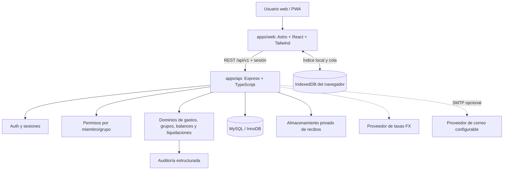

# Arquitectura de Pazito

## Contexto

Aplicación de gastos compartidos para compañeros de vivienda, parejas, familias, amistades, viajeros y organizadores de eventos. La meta de producto es que una persona pueda registrar un gasto rápidamente y que todas las personas puedan comprender cómo se calculan su saldo y las deudas.

## Diagrama de contexto



## Estructura

- `apps/web`: la aplicación Astro/React existente. No contiene autoridad financiera ni debe decidir si un usuario está autorizado.
- `apps/api`: aplicación Express en un proceso Node. Los módulos de dominio comparten proceso y base de datos: no son microservicios.
- `packages/contracts`: schemas Zod y tipos compartidos para solicitudes/respuestas. Es un contrato de validación compartido, no un lugar para lógica contable privada del servidor.

## Capas backend

```text
HTTP route / middleware
  -> parseo + validación runtime (Zod)
  -> autorización por grupo/recurso
  -> caso de uso del módulo
  -> lógica de dominio pura (split, balances, FX exacto)
  -> repositorios/consultas Drizzle
  -> MySQL InnoDB
```

Actualmente algunas rutas ejecutan consultas Drizzle directamente dentro de funciones de caso de uso del módulo; esto se conserva deliberadamente para evitar capas de repositorio vacías. Las operaciones financieras con múltiples escrituras usan transacciones y los cambios de gastos/liquidaciones se coordinan con bloqueo del registro de grupo cuando procede.

## Dominios

- `auth`, `users`: cuentas, sesiones revocables, recovery tokens, exportación y anonimización.
- `groups`, `invitations`: membresías, roles, permisos configurables, invitaciones seguras.
- `expenses`: gastos archivables, reparto equitativo/montos/porcentaje y snapshots de conversión.
- `balances`: saldos derivados de gastos, participaciones y liquidaciones confirmadas.
- `settlements`: declaración, confirmación, disputa y cancelación manual; no mueve dinero real.
- `categories`, `receipts`, `reports`, `fx`, `sync`, `health`: capacidades de apoyo.

## Reglas financieras

1. `amountMinor` es un entero seguro JSON expresado en la unidad menor de la moneda de ese campo. Internamente se convierte a `bigint`; no se hacen cálculos con `number`/float.
2. Se guarda importe/moneda originales y un importe convertido a la moneda de liquidación del grupo. La tasa, fuente y fecha usadas quedan fijadas en el gasto; no se reescriben si el proveedor FX cambia su tasa después.
3. Al repartir, el total de las participaciones originales suma exactamente el importe original. La asignación convertida emplea mayor resto y suma exactamente el total convertido.
4. El saldo neto es `pagos efectuados por el usuario en gastos - sus participaciones + liquidaciones confirmadas pagadas - liquidaciones confirmadas recibidas`, con el signo adaptado a la convención del código (positivo = acreedor). La suma del grupo debe ser cero.
5. Una liquidación declarada/disputada no reduce el balance publicado, pero reserva saldo disponible para prevenir declaraciones concurrentes que superen la deuda. Confirmar actualiza el balance; disputar/cancelar conserva el historial.
6. La propuesta “quién paga a quién” utiliza un greedy determinista. No afirma ser la solución matemáticamente mínima para todos los grafos posibles.

## Seguridad y confianza

- Autenticación y autorización son diferentes. IDs UUID no prueban acceso; cada recurso se consulta junto con membresía activa/permisos.
- Sesión: token opaco de alta entropía; solo su SHA-256 se guarda en DB. La cookie es `HttpOnly`, `SameSite=Lax`, `Secure` en producción. El frontend actual puede enviar el token de sesión en memoria mediante Bearer; no se guarda token de larga vida en `localStorage`.
- Mutaciones con cookie se protegen verificando Origin/Referer contra `FRONTEND_ORIGINS`.
- Contraseñas: Argon2id. Reset y invitaciones tienen hash de token, expiración y consumo de un solo uso.
- Los logs no deben almacenar passwords, cookies, bearer tokens, tokens de reset, enlaces de invitación o cuerpos financieros completos.
- Las operaciones offline pasan por autenticación, permisos actuales y validación en servidor en el momento de sincronizar. La clave idempotente está vinculada al usuario, operación y hash del payload.
- Los resultados idempotentes se cifran con AES-256-GCM porque una respuesta de invitación puede contener un enlace con token. Rotar `SESSION_SECRET` requiere invalidar sesiones y tratar las respuestas de idempotencia antiguas.
- Recibos guardados en disco privado, con límite de tamaño y detección de formato por firma; no se exponen mediante un static directory.

## Límites/decisiones pendientes

- Se necesita ejecutar y probar la migración sobre MySQL 8.4 limpio y realizar pruebas de integración concurrentes antes de producción.
- Almacenamiento local de recibos solo es apto para desarrollo/instancia única; un despliegue multi-instancia debe definir almacenamiento compartido privado.
- SMTP, sus cuotas gratuitas, y hosting no se han elegido. `EMAIL_TRANSPORT=log` es exclusivamente desarrollo; producción exige SMTP.
- El proveedor FX es una referencia indicativa y externa; no equivale a precio de una transferencia ni cotización bancaria garantizada.
- El modo offline completo aún requiere E2E de cola, conflictos de edición, borrado/revocación de permisos, múltiples dispositivos y UX de fallos parciales.
